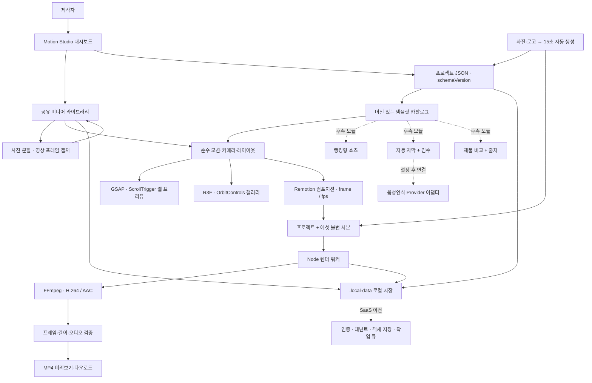
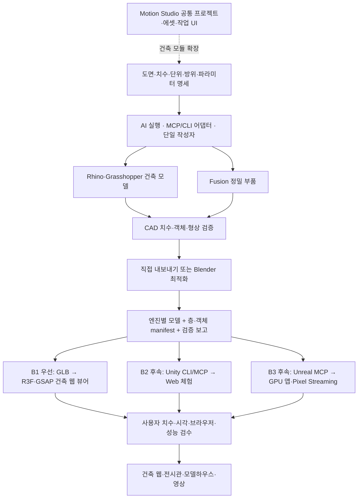

# Motion Studio — 구조도

> 2026-10-30 범위 변경: 도면 생성·법규 판정·새 CAD 모델링은 현재 개발에서 제외합니다. Arch-Studio와 겹치는 부분은 참고하고 가져온 파일의 검증·미리보기·웹/3D/영상 제작을 진행합니다. 아래 기존 CAD 생성안보다 [파일 기반 제작 기준](IMPORT_WORKFLOW.md)이 우선합니다.

시각 구조도: [SVG](public/architecture.svg), 앱 화면: `/architecture`.

## 실제 코드 경계

웹 제작기 MVP는 `components/WebsiteBuilder.tsx`(입력·저장·재열기), `components/WebsitePreview.tsx`(공통 랜딩 템플릿), `lib/website.ts`(입력 계약), `lib/server/websites.ts`(전용 JSON 저장), `/api/websites`와 `/api/websites/[id]`(목록·생성·조회·갱신)로 분리한다. 저장 경로는 `.local-data/websites/`이며 영상 프로젝트 목록과 분리한다. `/websites/[id]`는 저장된 내용으로 미리보기를 제공한다. 기존 미디어 삭제는 웹 프로젝트의 대표 이미지 참조도 검사한다.

| 경계 | 현재 파일 | 책임 |
| --- | --- | --- |
| 대시보드·편집 | components/Studio.tsx | 프로젝트·미디어·렌더 관리 |
| 빠른 제작 | components/QuickCreate.tsx | 사진·로고 입력만으로 생성 요청 |
| 템플릿 계약 | lib/template-catalog.ts | 지원 상태, 입력·출력, 15초 프로젝트 생성 |
| 웹 모듈 | components/MotionShowcase.tsx | GSAP·ScrollTrigger 랜딩 프리뷰 |
| 3D 모듈 | components/MotionGallery.tsx | 탐색·확대·자동 투어 |
| 공통 씬 | lib/motion.ts, components/PhotoWall.tsx | 결정적 카메라·배치, 공통 R3F 렌더 |
| 브랜드 | components/BrandOverlay.tsx | 웹·영상 공통 로고·타이틀 |
| 영상 모듈 | remotion/Intro.tsx, remotion/root.tsx | 프레임 시계·컴포지션 메타데이터 |
| 저장 | lib/server/store.ts | 파일 ID·검증·JSON·스트리밍 |
| 작업 관리 | lib/server/render.ts | 에셋 사본·동시성·상태·프로세스 |
| 렌더 실행 | scripts/render-worker.cjs | 브라우저·Remotion·인코딩·취소 |
| 자동 생성 API | app/api/create-intro/route.ts | 템플릿 검증→저장→렌더 시작 |

## 계약과 확장

SVG → PNG 변환은 Rust **resvg** 공통 계약으로 확장한다. 웹은 Node 서버 어댑터, 향후 데스크톱은 런타임에 맞는 Rust/Node 어댑터를 계획한다. 브라우저 오프라인 요구 시 WASM을 검토한다. 기존 사진 처리·3D 렌더·영상 인코딩과 책임을 분리하며 현재 런타임 연결은 미구현이다. 상세 구조도·계약: [SVG 래스터화 기획](RASTERIZATION_SPEC.md).

현재 Project의 선택 필드 contentType/templateId/templateVersion은 기존 schemaVersion 1 프로젝트와 호환된다. 빠른 제작은 사진·로고 입력을 정규화된 Project로 바꾼 뒤 기존 렌더 파이프라인을 재사용한다. 향후 모듈은 입력 검증과 compositionId를 추가하며 미디어 저장·스냅샷·작업 상태 UI를 복제하지 않는다.

랭킹·자막·제품 비교의 입력 타입은 미리 분리했지만, 컴포지션과 자동 음성인식은 아직 구현하지 않았다. SaaS 전환 시 파일 저장 어댑터와 렌더 작업 실행기를 교체하고 모든 레코드·파일에 tenantId 경계를 추가해야 한다. 로컬 파일 시스템을 그대로 인터넷에 노출하는 배포는 이 설계의 완료 상태가 아니다.

## AI 건축 확장 — 계획

상세 기획: [ARCHITECTURAL_STUDIO_PLAN.md](ARCHITECTURAL_STUDIO_PLAN.md). 새 시각 구조도: [시스템](public/architectural-system.svg), [개발주기](public/architectural-lifecycle.svg).

MCP/CLI는 제작 소프트웨어 제어, 변환은 엔진용 자산 생성, 런타임은 표시·상호작용, Motion Studio는 프로젝트·작업·결과 관리를 담당한다. 건축 모델용 별도 검증·저장 API를 추가했으며 사진 미디어 API와 /gallery에는 CAD 기능을 섞지 않는다. 향후 CAD 원본·시각화 모델·객체 메타데이터의 revision을 함께 연결한다.
# 건축 모델 라이브러리 MVP

- `app/architecture/viewer`: 파라메트릭 샘플, 브라우저 로컬 GLB 미리보기, 저장 모델 선택.
- `POST /api/models`: 100 MiB 이하 GLB 2.0 파일의 매직·길이·JSON scene/node/mesh 검증 후 저장.
- `GET /api/models`: 저장 모델 메타데이터 목록.
- `GET /api/models/{id}/asset`: GLB 바이트 스트림과 HTTP Range 재생성.
- `DELETE /api/models/{id}`: 라이브러리의 명시적 삭제 확인 뒤 자산·메타데이터 제거.
- 예제 `public/models/pavilion-demo.glb`: 3개 층·남측 커튼월의 계층·storeyId 메타데이터가 포함된 개념 모델. 생성 스크립트는 `scripts/build-pavilion-glb.cjs`.
- GLB는 원래 미터 축척으로 표시하고 장면 경계에 맞춰 카메라만 자동 조정한다. `storeyId`가 있는 모델은 층 표시·분해를 적용한다.
- 저장 위치: `.local-data/models/{id}.glb`와 대응 JSON. Compose 볼륨을 구성했으며 Docker 실행은 보류.
- 저장은 명시적 버튼으로만 실행하며, 파일을 고르는 행위는 브라우저 내 미리보기만 수행. 라이브러리에서 삭제할 때는 확인창을 표시.
- 제한: CAD 원본 `.3dm/.f3d`, 파라미터 편집, 사용자 인증, 공유·삭제·버전 이력은 미구현.
