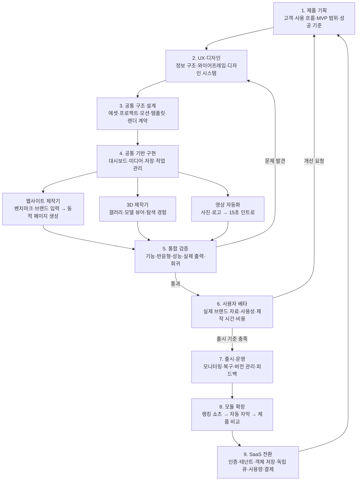
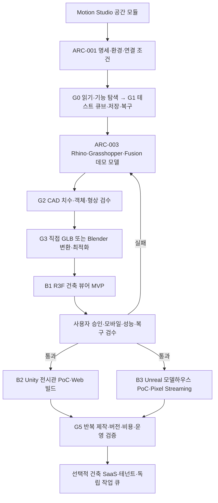

# Motion Studio — 전 생애 개발주기

2026-10-29. 현재 구현은 기획을 검증하기 위한 1차 프로토타입이며 플랫폼 전체의 출시 완료가 아니다.

## 단계별 산출물과 게이트

| 단계 | 산출물 | 다음 단계 기준 |
| --- | --- | --- |
| 제품 기획 | PLATFORM_PLAN.md, PRD.md, 대상 사용자·문제·범위·성공 기준 | 우선 제작 흐름과 제외 범위가 명확함 |
| UX·디자인 | IA, 대시보드·생성·편집·결과 시안, DESIGN.md | 첫 제작 흐름과 모바일·오류·빈 상태를 설명 가능 |
| 구조 설계 | ARCHITECTURE.md, 데이터·템플릿 버전·모듈 계약 | 웹·3D·영상의 공통·전용 책임이 구분됨 |
| 공통 구현 | 미디어·프로젝트·모션·저장·렌더 작업 | 새로 등록→저장→다시 열기→재생 가능 |
| 모듈 구현 | 벤치마크 기반 웹사이트 생성기, 3D 갤러리·모델 뷰어 제작기, 15초 자동 인트로 | 입력 자료부터 생성·수정·미리보기·내보내기까지 각 흐름이 작동함 |
| 통합 검증 | 타입·자동·브라우저·출력 증거 | 오류 복구, 프레임·음악·모바일 검증, 주요 회귀 없음 |
| 사용자 베타 | 사용성 피드백, 비용·실패율·제작 시간 | 실제 자료로 반복 제작·복원·다운로드 가능 |
| 출시·운영 | 실행·배포·복구 문서, 버전·관측 지표 | 운영 가능한 범위와 책임·복구 절차가 정해짐 |
| 확장 | 모듈별 PRD·입력 스키마·컴포지션·검증 | 새 모듈도 같은 검증·베타 주기를 통과 |

## 현재 위치

2026-10-30 후속 확장: 전역 GNB·13개 모션·720p~4K 해상도·CapCut 미디어 전달·공통 레퍼런스·홈페이지 메타데이터 가져오기·네이버 블로그 스킨 출력 MVP를 구현·검증한다. 실제 CapCut 네이티브 프로젝트 변환, 네이버 계정 설치, Dribbble 제한 해제, 임의 사이트 전체 시각 분석은 완료 범위가 아니다. 현재 동작은 각 제작기와 [블로그 기획](NAVER_BLOG_STUDIO.md), [레퍼런스 기획](REFERENCE_WORKFLOW.md)에 명시한다.

2026-10-30: 도면 생성과 중복 CAD/법규 엔진 개발은 제외하고 가져온 파일 기반 제작을 진행한다. [파일 기반 제작 기준](IMPORT_WORKFLOW.md)을 우선하며 이전 CAD 생성 트랙은 과거 확장안으로 보존한다. Docker·resvg 등 보류 항목은 해당 기능이 필요한 단계에서 재개한다.

- 기획·디자인·공통 구조: v0.2 문서와 화면을 작성했고 사용자 검토·피드백에 따라 수정하는 중.
- 공통 기반: 로컬 대시보드·미디어·저장·렌더를 1차 구현·검증.
- 웹사이트 제작기: 브랜드 브리프·참고 URL·공유 사진 입력 → 랜딩 템플릿 미리보기 → 저장·수정·재열기 MVP 구현. 소개·서비스·문의 섹션의 표시·순서·문구 편집과 단일 HTML 내보내기를 추가했다. 자동 분석·자유 배치·자동 배포는 후속 단계. `/showcase`는 별도 모션 데모.
- 3D 갤러리·뷰어: 사진 갤러리와 GLB 뷰어 시제품. 자산으로 갤러리/공간을 구성하는 제작 편집기는 아직 아님.
- 영상: 사진·로고 입력에서 15초·450프레임 MP4 생성과 다운로드까지 검증.
- 사용자 베타·상용 출시: 미진행. 실제 로고·사진·음원과 시각 품질 검수가 필요.
- 랭킹 쇼츠·자막·비교: 기획·타입·카탈로그 단계. 실제 생성기는 아직 없음.
- SaaS: 후속 설계 단계. 외부 AI·계정·결제는 연결하지 않음.

## 확장 순서

1. 웹 제작기 UX와 벤치마크 입력·분석·브랜드 브리프·섹션 구성·페이지 생성 흐름을 설계한다.
2. 생성 페이지 미리보기·시각 편집·재생성·코드/정적 사이트 내보내기 MVP를 만든다.
3. 3D 갤러리와 모델 뷰어를 자산 등록·장면 구성·인터랙션 편집을 지원하는 제작 흐름으로 확장한다.
4. 현재 15초 인트로의 사용성·품질을 실제 브랜드 자료로 검수한다.
5. 랭킹 쇼츠 → 자동 자막 → 제품 비교 순으로 영상 생성 모듈을 확장한다.
6. 검증된 작업량과 비용을 바탕으로 계정·테넌트·큐·사용량·결제의 SaaS 기반을 연결한다.

각 확장도 기획→디자인→구현→검증→베타를 반복한다. 모델 이름이나 낙관적인 예상 일정만으로 완료를 판단하지 않는다.

## 공간 모듈의 AI 건축 개발 트랙 — 추가

이 트랙은 공통 기반에서 분기하며 기존 영상·웹 개발을 되돌리지 않는다. 시스템·연결은 ARCHITECTURAL_STUDIO_PLAN.md와 MCP_INTEGRATION.md를 기준으로 한다.

첫 B1은 회전·층별 보기·재질 변경·카메라 투어를 목표로 한다. B2는 전시실 1개·작품 10개·이동·투어, B3는 공간 2개·재질 3종·스트리밍 세션을 작은 PoC로 검증한다. Unity·Unreal의 우선순위는 B1 결과와 체험 요구·운영 비용에 따라 정한다.

현재는 건축 기획·명세·구조도만 추가한 상태다. CAD 앱 연결·모델 생성·변환·건축 런타임은 미실행이다. 외부 도구가 준비되지 않아도 명시적으로 제공된 수동 GLB로 뷰어 개발을 병행할 수 있다.
