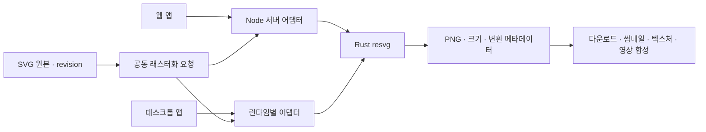

# SVG 래스터화 — Rust resvg 적용 기획

결정일: 2026-10-29. 상태: 블로그 제작기의 애플리케이션 생성 SVG → PNG 경로 구현. 사용자 SVG 업로드·일반 변환·데스크톱 어댑터는 후속 범위.

웹 앱과 향후 데스크톱 앱에서 SVG를 래스터 이미지로 변환할 때 Rust 기반 **resvg**를 공통 엔진으로 사용한다. 데스크톱 프레임워크는 별도 결정하며, 블로그 제작기의 Node 서버 어댑터에 @resvg/resvg-js 2.6.2를 연결했다. 데스크톱 패키징과 사용자 SVG 업로드는 수행하지 않았다.

## 적용 기준

| 상황 | 처리 원칙 |
| --- | --- |
| 로고·아이콘·구조도 SVG의 PNG 다운로드 | resvg로 지정 크기와 배경의 PNG 생성 |
| SVG의 썸네일·3D 텍스처·영상 합성용 정적 이미지 | 비트맵이 필요한 소비 지점에서 resvg 파생 이미지 생성 |
| 확대 가능한 SVG 표시·편집·원본 다운로드 | 벡터 원본 유지, 파생물은 필요할 때 생성 |
| JPG·PNG·WebP 사진의 크롭·리사이즈·재인코딩 | 기존 Sharp 처리 경로 유지 |
| 웹페이지 캡처·CSS 레이아웃·3D 장면·영상 렌더 | 각각 브라우저·3D 엔진·Remotion/FFmpeg 경로 사용 |

resvg는 SVG 정적 래스터화를 담당한다. SVG 애니메이션은 시간별 정적 SVG 생성과 래스터화를 분리해 별도 검증한다.

## 웹·데스크톱 공통 경계

- 요청: SVG 원본 또는 에셋 ID, 출력 픽셀 폭·높이, 비율 맞춤 규칙, 배경색 또는 투명, 폰트 묶음 식별자.
- 결과: PNG 바이트 또는 파생 에셋 ID, 실제 픽셀 크기, 원본 ID·revision, 변환 옵션, 엔진 버전, 오류·경고.
- 웹 앱: Node 서버의 resvg 어댑터를 우선한다. Node 바인딩 후보는 `@resvg/resvg-js`다. 네이티브 모듈은 브라우저 번들에 포함하지 않는다.
- 데스크톱 앱: Rust 백엔드 선택 시 resvg crate를 직접 사용하고 Node 런타임 선택 시 Node 어댑터를 재사용한다. UI는 동일한 요청·결과 계약을 사용한다.
- 브라우저 내 오프라인 변환이 필요할 때 WASM 어댑터를 검토한다. 데스크톱 패키징·WASM 지원은 후속 검증 항목이다.
- 엔진·바인딩 버전을 호환성 확인 후 고정하고 OS별 결과를 공통 픽스처로 비교한다. 엔진 선택만으로 플랫폼 간 픽셀 일치를 보장하지 않는다.

## 에셋·품질 정책

SVG 원본을 보존하고 PNG는 파생물로 저장한다. 캐시 키는 원본 해시·픽셀 크기·비율 규칙·배경·폰트 해시·엔진 버전으로 구성한다. 화면 배율은 최종 픽셀 크기로 환산한다. 한쪽 크기만 지정하면 종횡비로 나머지를 계산하고, 두 크기를 지정하면 기본은 비율 유지·영역 맞춤이다.

기본 출력은 알파를 보존한 PNG다. JPEG/WebP는 resvg 출력 후 별도 인코딩하며 JPEG에는 배경색을 명시한다. 한글·영문 폰트를 명시적으로 공급하고 라이선스와 패키징 가능 여부를 확인한다. 시스템 폰트 자동 탐색에 따른 결과 차이는 피한다.

외부 URL·임의 로컬 파일 참조는 기본 허용하지 않고 승인된 에셋만 해석한다. 어댑터에서 입력 바이트·출력 픽셀·처리 시간·메모리 한도를 검증한다. 미지원 요소·폰트 누락·변환 실패는 알리고 성공 결과로 저장하지 않는다. SVG 업로드 지원과 검증은 별도 구현 대상이며 현재 미디어 API의 지원 형식에 포함되었다고 표시하지 않는다.

## 구현 순서와 완료 기준

1. 공통 요청·결과 타입과 크기·비율·투명도 정책 확정.
2. Node 변환 어댑터, 원본/파생 에셋 저장·캐시 구현.
3. PNG 다운로드·썸네일 등 실제 비트맵 소비 지점에 연결.
4. 데스크톱 런타임 결정 후 해당 어댑터 구현. 브라우저 오프라인 요구 확정 시 WASM 검증.
5. 한글·영문, 투명 로고, 그라디언트, 클리핑·마스크, 내장 이미지, viewBox·배율별 시각 회귀 검증.
6. 대상 OS의 크기·알파·메모리·처리 시간과 외부 참조·과대 입력·실패 처리를 검사하고 웹/데스크톱 지원 환경 명시.

## 기술 근거

- [resvg 공식 저장소](https://github.com/linebender/resvg): Rust SVG 렌더링 엔진.
- [resvg-js 공식 저장소](https://github.com/thx/resvg-js): Rust resvg 기반 Node 바인딩 및 WASM 경로 참고.

설치 버전, 지원 SVG 기능, 바이너리 배포 대상과 라이선스는 구현 시 선택한 릴리스 기준으로 검증한다.
