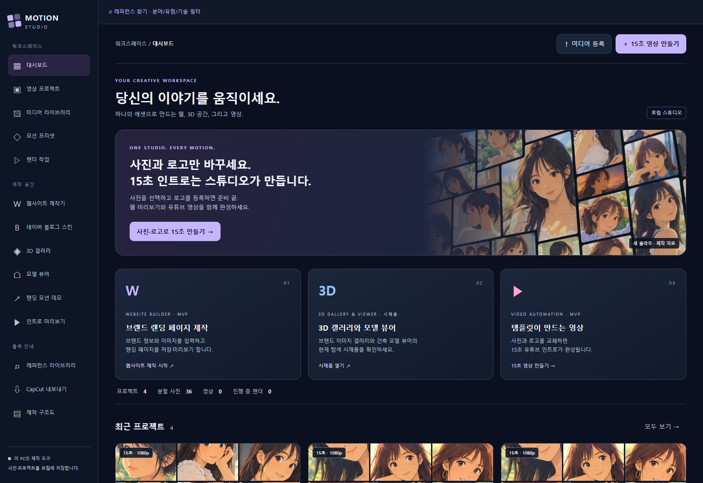
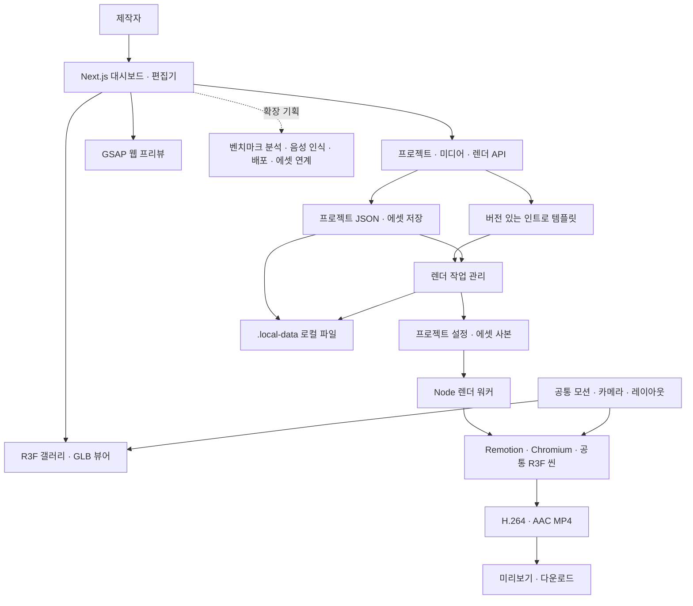

# Motion Studio

하나의 공유 미디어·모션 기반에서 웹, 3D 공간, 영상을 만드는 로컬 제작 플랫폼입니다.

첫 템플릿: **사진 6~36장 + 로고 → 15초 유튜브 인트로 → 1080p MP4**.

저장소: [DevOps0906/Motion-Studio](https://github.com/DevOps0906/Motion-Studio) · 기본 브랜치: `main`.

## 진행 현황 (2026-10-30 기준)

현재 단계는 **로컬 MVP 구현 후 웹사이트 제작기 고도화·통합 검증**입니다. 전체 제품 개발 진행률은 **약 66%**로 추정하며, 공개 서비스 출시와 고객 베타는 아직 완료하지 않았습니다. 이 수치는 영역별 구현 범위와 검증 수준을 평가한 계획용 가중 추정치입니다. 실제 투입 시간·티켓 완료율·테스트 통과율을 뜻하지 않으며, 범위가 바뀌면 다시 산정합니다. 상세 이력과 검증 한계는 [구현·검증 상태](docs/development/IMPLEMENTATION_STATUS.md), 단계별 산출물은 [개발 생애주기](docs/development/DEVELOPMENT_LIFECYCLE.md)를 따릅니다.

| 영역 | 현재 상태 |
|---|---|
| 공통 제작 기반 | 프로젝트 생성·열기·복제·삭제, 사진·영상·음악 등록과 형식·디코딩 검사, 저장·재열기, 제작 기본 설정·앱 테마가 구현됐습니다 |
| 웹사이트 제작기 | 홈+추가 페이지 최대 12개, 페이지별 콘텐츠·섹션 편집, 미리보기, 단일 HTML·사이트 ZIP 출력이 구현됐습니다. 실제 브라우저 검수, 문의 전송, URL 분석·AI 생성·배포는 남아 있습니다 |
| 영상·콘텐츠 | 15초 인트로, 모션 13종, 콘텐츠 템플릿 9종, MP4·미디어 ZIP 출력이 구현됐습니다. 음성 인식·시간 편집과 장시간·고해상도 부하 검증은 남아 있습니다 |
| 홈페이지형 블로그 디자인 | 주소 기반 규칙형 초안, 페이지 구성, PNG·위젯·설치 ZIP이 구현됐습니다. 실제 AI 호출과 실제 블로그 계정 설치·모바일 검수는 남아 있습니다 |
| 3D 제작 | GLB 등록·라이브러리·뷰어와 메타데이터 기반 층 표시·분해가 구현됐습니다. 공간·객체·재질·카메라 편집은 후속 범위입니다 |
| 계정·고객 운영 | 로컬 로그인·세션, 고객 진단·접수·조회·CSV가 구현됐습니다. 계정별 자료 분리·팀 권한·CRM·알림은 남아 있고 로그인 확장은 현재 우선순위에서 제외했습니다 |
| 공개 배포·운영 | 로컬 실행·프로덕션 빌드와 Docker 설정 파일이 있습니다. 컨테이너 실행 재검증, HTTPS·도메인, 백업·복구·모니터링은 남아 있습니다 |

**제품 제한:** 실제 다중 사용자 SaaS 운영, 결제·클라우드 큐·자동 배포는 구현하지 않았습니다. 블로그 AI는 규칙 기반 초안과 선택형 API 호출 경로만 있고 실제 호출은 검증하지 않았습니다. 자동 검증은 타입 검사·테스트·프로덕션 빌드 기준이며 ESLint는 구성하지 않았습니다. Arch-Studio의 구현 실적과 현재 범위에서 제외한 CAD 자동 설계·법규 엔진은 아래 진행률에 포함하지 않습니다.

### 작업 진행률

| 개발 영역 | 비중 | 진행률 | 주요 남은 작업 |
|---|---:|---:|---|
| 공통 제작 기반 | 15% | 90% | 버전 관리·복구·반복 제작 안정화 |
| 웹사이트 제작기 | 25% | 70% | 다중 페이지 브라우저 검수, 섹션·에셋 확장, 실제 문의 전송, 벤치마크 분석·생성·배포 |
| 영상·콘텐츠 | 20% | 85% | 음성 인식·시간 편집·SRT, 전체 길이·고해상도 부하 검증 |
| 홈페이지형 블로그 디자인 | 10% | 80% | 실제 AI 호출, 실제 블로그 계정 설치·모바일 검수 |
| 3D 제작 | 10% | 35% | 공간·객체·재질·카메라 편집, 웹·영상 연계 |
| 계정·고객 운영 | 10% | 40% | 계정별 자료 분리·팀 권한·CRM·알림 연계 (로그인 확장 보류) |
| 공개 배포·운영 | 10% | 20% | 컨테이너 재검증, HTTPS·도메인, 백업·복구·모니터링, 클라우드 큐·사용량·결제 |

계산은 `Σ(비중 × 영역 진행률) ÷ 100 = 65.5% ≈ 66%`입니다. 작업표(티켓) 단위 집계는 아직 없어 개수 기준 완료율은 제공하지 않습니다.

| 단계 | 현재 상태 | 완료 기준 |
|---|---|---|
| 1. 기획·설계·공통 기반 | 1차 완료 | 제작 범위·입력 계약·저장 구조·기본 화면 정의, 미디어 등록→저장→재열기 구현 |
| 2. 로컬 제작 MVP | 구현 완료·지속 개선 | 웹·블로그·영상의 입력→편집→저장→출력 흐름 제공, 3D는 뷰어 MVP |
| 3. 웹사이트 제작기 고도화 | **현재 진행 중** | 다중 페이지·독립 콘텐츠·출력 연결 완료, 브라우저 검수와 실제 고객 제작 기능 보강 |
| 4. 통합 검증·사용자 베타 | 일부 검증 완료·베타 대기 | 실제 브랜드 자료로 데스크톱·모바일·페이지 이동·오류 복구·다운로드 검수 |
| 5. 공개 서비스 출시·운영 | 미완료 | 공개 접속·운영자 권한·데이터 보관·백업 복구·장애 관측을 실제 환경에서 확인 |
| 6. 선택적 SaaS 확장 | 후속 계획 | 계정별 자료 격리·팀·독립 큐·사용량·결제 구현 및 운영 검증 |

`구현 완료`는 MVP 기능이 코드와 출력 흐름에 연결됐다는 뜻이고, `출시 완료`는 4~5단계까지 실제 환경에서 검수했을 때 판단합니다.

### 구현된 주요 항목
- [x] Motion Studio 대시보드와 프로젝트 생성·열기·이름 변경·복제·삭제를 구현했습니다.
- [x] 사진·영상·음악 등록, 실제 형식·디코딩·용량 검사, 캡처 이미지 영역 분할, 영상 프레임 추출을 구현했습니다.
- [x] 공유 R3F 씬과 GSAP 재생·스크럽, 15초 자동 생성, 버전 있는 템플릿 카탈로그, 설정과 파일 사본에 고정된 Node 렌더 작업(진행률·취소·재시도·MP4 다운로드)을 구현했습니다.
- [x] 랭킹·자막 배치·제품 비교 템플릿 각 3종의 입력·저장·미리보기·MP4 출력을 구현했습니다. 자막은 입력 문장 배치이며 음성 전사는 연결하지 않았습니다.
- [x] 웹사이트 제작기 `/websites`에서 브랜드 브리프·참고 URL·공유 이미지, 홈과 추가 페이지 최대 12개 저장·재열기·미리보기를 구현했습니다.
- [x] 페이지별 소개·서비스·문의·버튼 문구와 홈 내용 상속, 섹션 표시·순서, 미리보기 메뉴 이동을 구현했습니다.
- [x] 상대 링크가 연결된 전체 사이트 ZIP과 단일 HTML 출력을 구현했습니다.
- [x] 로컬 회원가입·로그인, 제작 기본 설정·앱 테마, 고객 요구사항 진단·접수·운영자 조회·CSV 출력을 구현했습니다.
- [x] 건축 뷰어의 GLB 2.0 미리보기와 프로젝트 모델 라이브러리 등록·재열기 API를 구현했습니다.
- [x] 위 다중 페이지 변경이 타입 검사·자동 회귀 테스트·프로덕션 빌드를 통과했습니다.

### 다음 개발 단계
- [x] 실제 브라우저에서 다중 페이지 편집·저장·재열기·ZIP 열기와 모바일 흐름을 검수했습니다(2026-11-01, Chrome·390px 폭 기준, 실기기 터치는 미확인).
- [ ] 웹사이트 섹션 종류와 페이지별 이미지·콘텐츠 구성을 확장합니다.
- [ ] 고객 홈페이지의 실제 문의 전송과 운영자 알림을 연결합니다.
- [ ] 벤치마크 분석·초안 생성 범위를 구체화하고 구현합니다.
- [ ] 공개 운영 환경과 백업·복구·모니터링을 검증합니다.

기능 구현·검증·범위가 바뀔 때 이 절의 표와 체크 목록을 함께 갱신합니다.

## 콘텐츠 바로가기

제작 콘텐츠별로 화면 경로, 기획·명세 문서, 구현 코드를 한곳에서 찾을 수 있습니다. 화면 경로는 로컬 실행(`npm run dev`) 후 접속하는 주소이고, 문서·코드 링크는 이 저장소 안의 파일로 이동합니다.

| 콘텐츠 | 화면 경로 | 기획·명세 문서 | 구현 코드 |
|---|---|---|---|
| 영상 인트로·모션 | `/studio` | [영상·콘텐츠 제작](docs/features/video/README.md) · [로컬 제작과 CapCut 내보내기](docs/features/video/CAPCUT_EXPORT.md) | [`remotion/`](remotion) · [`app/studio/`](app/studio) |
| 콘텐츠 템플릿 9종 | `/content/[template]` | [콘텐츠 레퍼런스 템플릿](docs/features/video/CONTENT_TEMPLATES.md) | [`app/content/`](app/content) · [`components/ContentTemplateBuilder.tsx`](components/ContentTemplateBuilder.tsx) |
| 웹사이트 제작기 | `/websites` | [웹사이트 제작](docs/features/websites/README.md) · [상품 전략](docs/features/websites/WEBSITE_SERVICE_PRODUCTS.md) · [상품 체계](docs/features/websites/WEBSITE_SYSTEM_PRODUCTS.md) | [`app/websites/`](app/websites) |
| 고객 개발요구사항 진단 | `/website-requirements` | [진단·상담 접수](docs/features/websites/WEBSITE_REQUIREMENTS.md) | [`app/website-requirements/`](app/website-requirements) · [`components/WebsiteRequirements.tsx`](components/WebsiteRequirements.tsx) |
| 홈페이지형 블로그 디자인 | `/blog-skins` | [제작기](docs/features/blog/HOMEPAGE_BLOG_DESIGN.md) · [주소·레퍼런스 자동 기획](docs/features/blog/BLOG_AUTOPLAN.md) | [`components/BlogSkinBuilder.tsx`](components/BlogSkinBuilder.tsx) · [`lib/blog-skin.ts`](lib/blog-skin.ts) |
| 레퍼런스 라이브러리 | `/references` | [레퍼런스 활용 기획](docs/references/REFERENCE_WORKFLOW.md) · [경쟁 서비스 벤치마킹](docs/references/BENCHMARK.md) | [`app/references/`](app/references) |
| 3D 갤러리·모델 뷰어 | `/gallery` · `/architecture/viewer` | [건축·3D 확장 설계](docs/architecture/3d/README.md) | [`app/gallery/`](app/gallery) · [`app/architecture/`](app/architecture) |
| 제작 구조도 | `/architecture` | [플랫폼 구조](docs/architecture/ARCHITECTURE.md) · [파일 기반 제작 범위](docs/architecture/IMPORT_WORKFLOW.md) | [`app/architecture/`](app/architecture) |

전체 문서 목록은 [문서 안내](docs/README.md), 디자인은 [디자인 명세](docs/design/DESIGN.md), 진행 상태는 [구현·검증 상태](docs/development/IMPLEMENTATION_STATUS.md)에서 확인합니다.

## 연관·참고 저장소

| 저장소 | Motion Studio와의 연관성 | 참고 범위 |
| --- | --- | --- |
| [DevOps0906/Arch-Studio](https://github.com/DevOps0906/Arch-Studio) | 건축·공간 자료와 제작 흐름을 연계하는 관련 프로젝트 | 웹·데스크톱 구조, 파일 가져오기·검증, 원본·파생 에셋 관리, 모델·메타데이터 전달 설계 |

Motion Studio는 가져온 자료를 웹사이트·3D 체험·영상으로 제작하는 플랫폼입니다. Arch-Studio와 겹치는 구조와 파일 처리 설계를 참고하며, 두 프로젝트 사이의 파일·메타데이터 연계를 발전시키는 방향을 갖습니다. 현재 저장소 간 자동 동기화나 실행 시 서비스 의존성은 연결하지 않았습니다. 상세 기준은 [참고 저장소 목록](docs/references/REFERENCE_REPOSITORIES.md)과 [파일 기반 제작 기준](docs/architecture/IMPORT_WORKFLOW.md)을 따릅니다.

## 문서 안내

문서는 [docs/README.md](docs/README.md)에서 종류별로 찾을 수 있습니다. 제품 기획·설계·기능별 안내·디자인·개발 현황·참고 자료를 분류했고, 각 폴더 README에 문서 목록을 제공합니다.

## 제품 기획과 개발 범위

### 추가된 제작 기능

- **전역 GNB:** 웹·영상·3D·블로그·구조도·레퍼런스가 좌측 메뉴를 유지한 우측 콘텐츠에서 열립니다.
- **인트로:** 기존 3개에 10개를 추가한 13개 모션 프리셋. 빠른 제작·새 프로젝트·편집기에서 720p/1080p/1440p/4K 해상도를 선택합니다. [벤치마크·출력 규격](docs/design/MOTION_BENCHMARK.md)
- **CapCut:** 완료된 MP4 또는 사진·로고·음악 포함 ZIP을 내려받아 CapCut의 가져오기에서 사용합니다. ZIP은 먼저 풀어야 하며 네이티브 CapCut 프로젝트·키프레임 자동 변환은 아닙니다. [지원 범위](docs/features/video/CAPCUT_EXPORT.md)
- **웹 제작:** 홈페이지 정보 JSON/JSON-LD 가져오기로 브랜드·소개·서비스·문의 내용을 구성합니다. Awwwards 공개 검색 카드를 선택하면 분류를 자체 스튜디오/에디토리얼/갤러리 디자인에 매핑합니다. Dribbble 조회 제한 시 외부 검색·작품 URL 입력으로 이어갑니다. [메타데이터 양식](public/templates/website-metadata.sample.json)
- **모든 제작기의 레퍼런스:** 상단에서 분야·자료 유형·기술·검색어·북마크로 58개 탐색처를 필터링합니다. 목록 검색과 외부 검색은 구분하며 템플릿·코드·에셋을 자동 구매·다운로드하지 않습니다. [기획](docs/references/REFERENCE_WORKFLOW.md)
- **홈페이지형 블로그 디자인:** 브랜드·메뉴 링크·색상·로고·대표 이미지로 스킨 PNG를 만들고 타이틀·투명 위젯·좌표표·설치 안내 ZIP을 출력합니다. `resvg`를 실제 PNG 경로에 적용했습니다. [제작·설치 범위](docs/features/blog/HOMEPAGE_BLOG_DESIGN.md)

실행 중인 앱: [웹 제작기](http://127.0.0.1:4101/websites), [블로그 스킨](http://127.0.0.1:4101/blog-skins), [레퍼런스 라이브러리](http://127.0.0.1:4101/references), [CapCut 내보내기](http://127.0.0.1:4101/exports).

2026-10-30 범위: Arch-Studio와 중복되는 설계는 참고하고, **도면 생성 없이 가져온 파일로 제작**합니다. 현재 지원 형식과 보류 항목은 [파일 기반 제작 기준](docs/architecture/IMPORT_WORKFLOW.md)이 기존 CAD 확장 기획보다 우선합니다.

웹 제작기는 `http://127.0.0.1:4101/websites`에서 사용합니다. 브랜드 정보·참고 URL·서비스·색상·공유 대표 이미지를 입력하면 랜딩 템플릿에 반영됩니다. 저장·수정·재열기와 저장된 페이지 미리보기를 지원하며 데이터는 `.local-data/websites/`에 저장합니다. 일반 참고 URL은 자료로 저장합니다. Awwwards 검색 결과를 선택한 경우 제목·분류를 읽어 자체 디자인 방향에 매핑하며 전체 사이트를 복제·분석하지 않습니다.

### 웹 페이지 편집·사이트 내보내기

1. `/websites`에서 프로젝트를 만들거나 저장된 프로젝트를 엽니다.
2. 첫 화면 아래의 소개·서비스·문의 섹션을 켜거나 끄고 위·아래 버튼으로 순서를 조정합니다. 소개·문의 문구와 문의 URL도 수정할 수 있습니다.
3. 필요하면 홈 외에 최대 12개 페이지를 추가합니다. 페이지별 이름·주소·제목·소개·섹션 표시와 순서를 편집할 수 있습니다.
4. `이 페이지의 상세 문구를 별도로 편집`을 켜면 소개·서비스·문의·버튼 문구를 독립적으로 설정합니다. 끄면 홈의 최신 내용을 따릅니다. 디자인과 대표 이미지는 공통입니다.
5. 미리보기를 확인한 뒤 프로젝트를 저장합니다. 변경 사항이 남아 있으면 내보내기 버튼은 비활성화됩니다.
6. 단일 페이지는 CSS·대표 이미지가 포함된 HTML, 다중 페이지는 `index.html`·추가 페이지 HTML·안내 파일이 포함된 ZIP으로 내려받습니다. 압축을 풀고 `index.html`을 열면 상대 링크로 페이지를 이동할 수 있습니다.

내보내기는 저장된 버전을 사용합니다. 문의 URL은 외부 페이지 연결이며 폼 전송·메일 발송·자동 배포는 포함하지 않습니다. 기존 웹 프로젝트는 원래 서비스 섹션 구성을 유지하며 새 섹션을 직접 활성화할 수 있습니다.

검증 스크립트: `node scripts/verify-website-export.cjs` (`WEBSITE_QA_URL`로 실행 서버 주소 지정, 기본 `http://127.0.0.1:4110`). 임시 QA 프로젝트·이미지를 만들고 정리하며 다운로드 HTML·화면 증거는 `out/qa/`에 보관합니다.

하나의 프로젝트·미디어 라이브러리를 웹사이트, 3D 공간, 영상 제작에서 공유하는 것이 목표입니다. 현재는 로컬 단일 사용자 제작 도구입니다.

| 작업 공간 | 현재 구현 | 다음 기획 |
| --- | --- | --- |
| 웹사이트 | `/websites` 브랜드·다중 페이지·독립 콘텐츠 편집, 저장·반응형 미리보기, HTML·사이트 ZIP 출력 | 벤치마크 분석·AI 생성, 자유 배치, 실제 문의 전송·배포 |
| 3D 공간 | R3F 사진 갤러리, GLB 건축 모델 미리보기·라이브러리 | 공간·객체 편집, CAD 파생 모델과 메타데이터 연계 |
| 영상 | 사진·로고 15초 인트로, 모션 13종, 랭킹·자막 배치·제품 비교 템플릿 9종, 서버 MP4 렌더 | 음성 인식·자막 시간 편집·대량 렌더 운영 |

첫 제작 흐름은 **사진 6~36장 선택 → 로고 선택 → 선택 브랜드명 입력 → 프로젝트 저장 → 렌더 → 결과 검수·다운로드**입니다. 기본 출력은 1920×1080, 30fps, 15초(450프레임), H.264 MP4이며 로고·브랜드 엔딩은 11.8~15초에 나타납니다. 음악은 선택 사항입니다.

개발 순서는 기획·입력 계약 → 화면 설계 → 공통 에셋·프로젝트 기반 → 모듈 구현 → 타입·계약·브라우저·영상 검증 → 문서·배포 검토입니다. 현재는 웹사이트 제작기를 우선 고도화합니다. 로컬 로그인은 구현돼 있으며 계정별 데이터 분리·팀·결제·클라우드 큐는 후속 범위입니다. 블로그 AI 호출 코드는 구현했지만 실제 API 호출 검증은 남아 있습니다. 음성 인식·CAD 도구 연결·자동 모델링도 미구현입니다. 새 CAD 설계·법규 엔진은 현재 개발 범위에서 제외하며, [파일 기반 제작 기준](docs/architecture/IMPORT_WORKFLOW.md)을 우선합니다.

## 디자인과 화면 구성

대시보드는 **제작 버튼 → 웹·3D·영상 작업 공간 → 실제 작업 수 → 프로젝트 → 공유 미디어 → 템플릿** 순서로 구성합니다. 빠른 제작에서는 사진과 로고를 분리하고, 상세 편집에서는 좌측 미디어·중앙 16:9 프리뷰·우측 속성·하단 타임라인을 사용합니다. 준비 중 기능은 기획 상태로 표시합니다.

| 디자인 항목 | 명세 |
| --- | --- |
| 배경 / 내비게이션 / 카드 | `#0B1020` / `#0E1526` / `#151E30` |
| 테두리 / 본문 / 보조 글자 | `#334155` / `#F1F5F9` / `#B6C2D6` |
| 강조 | `#C4B5FD`, 웹 보라·3D 파랑·영상 분홍 |
| 모서리 / 간격 / 글꼴 | 10~18px / 4px 배수 / 시스템 한글 sans-serif |
| 반응형·접근성 목표 | 1440·1024·390px, 키보드 포커스, 상태 문구, 모션 감소 설정 대응 |



디자인 원본: [화면 리뷰](design/dashboard.html), [빠른 생성 화면](design/motion-studio-quick-create.png), [모바일 화면](design/motion-studio-mobile.png), [상세 디자인 명세](docs/design/DESIGN.md).

## 프로그램 구조도

SVG의 래스터 출력은 웹·데스크톱 공통으로 Rust **resvg**를 사용하도록 기획했습니다. PNG 다운로드·썸네일·텍스처·영상 합성용 정적 이미지가 필요할 때 적용하고 벡터 원본은 보존합니다. 블로그 스킨 PNG 출력에 연결했으며 일반 SVG 업로드와 데스크톱 어댑터는 후속 범위입니다. 상세 계약은 [SVG 래스터화 기획](docs/architecture/RASTERIZATION_SPEC.md)을 참고하세요.



웹 프리뷰의 시간 제어는 GSAP, 영상은 Remotion의 frame/fps를 사용합니다. 렌더 API와 빠른 생성 API는 공통 작업 관리기를 사용하며, 제출 당시의 설정과 에셋을 복사해 결과의 재현성을 유지합니다.

```text
Motion-Studio/
├─ docs/             # 종류별 기획·설계·기능 안내·개발 현황·참고 문서
├─ app/              # 페이지와 API 라우트
├─ components/       # 대시보드·빠른 생성·웹/3D 프리뷰·공통 씬
├─ lib/              # 프로젝트 스키마·템플릿·모션 계산
│  └─ server/        # 파일 저장·모델 관리·렌더 작업
├─ remotion/         # 영상 컴포지션과 프레임 기반 렌더
├─ scripts/          # 렌더 워커·검증·샘플 모델 생성
├─ public/           # 샘플 사진·GLB·SVG 구조도
├─ design/           # 디자인 리뷰와 화면 이미지
├─ input/            # 예제 입력 자료
├─ .local-data/      # 실행 중 생성되는 프로젝트·미디어·작업 (Git 제외)
├─ out/              # 로컬 출력·검증 자료 (Git 제외)
└─ compose.yaml      # Docker 실행·데이터 볼륨
```

상세 구조도: [플랫폼 구조](docs/architecture/ARCHITECTURE.md), [플랫폼 SVG](public/architecture.svg), [건축 시스템 계획](public/architectural-system.svg), [건축 개발주기](public/architectural-lifecycle.svg).

## 실행

Node.js 24 LTS와 npm을 권장합니다. 처음 내려받은 환경에서는 의존성을 먼저 설치합니다.

```powershell
git clone https://github.com/DevOps0906/Motion-Studio.git
cd Motion-Studio
npm ci
```

현재 디렉터리 `Motion-Studio`에서 실행합니다. 기존 상위 작업 폴더에서 시작했다면 먼저 `cd Motion-Studio`를 실행하세요.

```powershell
npm run dev -- -p 4101 -H 127.0.0.1
```

- 대시보드: http://127.0.0.1:4101/studio
- 웹사이트 제작기: http://127.0.0.1:4101/websites
- GSAP 웹 랜딩 데모: http://127.0.0.1:4101/showcase
- 3D 포토 갤러리: http://127.0.0.1:4101/gallery
- 플랫폼 구조도: http://127.0.0.1:4101/architecture
- 건축 모델 뷰어: http://127.0.0.1:4101/architecture/viewer
- 예제 GLB: `public/models/pavilion-demo.glb` (시각 검토용 개념 모델, 구조·법규 검증용 아님).

### 실행 IP와 접속 주소

| 실행 방식 | 바인딩 주소 | 접속 주소 |
| --- | --- | --- |
| 로컬 개발·프로덕션 | `127.0.0.1:4101` | [대시보드](http://127.0.0.1:4101/studio), `http://localhost:4101/studio` |
| 동일 네트워크 접속 옵션 | `0.0.0.0:4101` | 현재 PC 기준 `http://192.168.35.83:4101/studio` |
| Docker 기본 설정 | 호스트 `127.0.0.1:4102` → 컨테이너 `3000` | [Docker 대시보드](http://127.0.0.1:4102/studio) |

`192.168.35.83`은 2026-10-29에 확인한 이 개발 PC의 이더넷 내부 IPv4이며 고정 주소나 공개 서비스 주소가 아닙니다. 공유기·네트워크가 바뀌면 `ipconfig`로 실제 IPv4를 확인해 주소를 바꿉니다. `0.0.0.0`은 서버 수신 설정이며 브라우저 접속 주소로 사용하지 않습니다.

다른 PC·휴대폰에서 접속하려면 기존 서버를 종료하고 다음과 같이 실행합니다.

```powershell
npm run dev -- -p 4101 -H 0.0.0.0
# 프로덕션은 npm run build 후:
npm run start -- -p 4101 -H 0.0.0.0
```

같은 네트워크에 연결되어 있어야 하며 Windows 방화벽의 해당 포트 허용이 필요할 수 있습니다. 로컬 로그인과 운영자 접수 조회 제한은 구현돼 있지만 제작 자료의 계정별 격리는 아직 없어 신뢰하는 내부망에서 사용합니다. Docker 기본 포트는 루프백에만 연결되어 다른 기기에서 접근할 수 없습니다. 아래 주소들은 실행 설정이며 서버가 상시 실행 중임을 의미하지 않습니다. Docker 컨테이너 실행은 별도 재검증이 필요합니다.

프로덕션 모드:

```powershell
npm run build
npm run start -- -p 4101 -H 127.0.0.1
```

같은 포트의 개발 서버를 종료한 뒤 프로덕션 서버를 시작합니다. 이번 작업은 Node.js 24.13.0·Windows·설치된 Chrome에서 검증했습니다. 렌더 브라우저를 바꾸려면 `REMOTION_BROWSER_EXECUTABLE`에 실행 파일 경로를 지정하세요. 기본 렌더 GL은 안정성을 위한 `swangle`이며 `REMOTION_GL`로 변경할 수 있습니다.

## Docker 백그라운드 실행

Docker Desktop을 실행한 상태에서 프로젝트 폴더에서 아래 명령을 실행합니다.

```powershell
docker compose up --build -d
docker compose ps
docker compose logs -f motion-studio
```

- 대시보드: http://127.0.0.1:4102/studio
- 건축 뷰어: http://127.0.0.1:4102/architecture/viewer
- 정지: `docker compose down` (프로젝트·미디어·렌더 결과는 유지)
- `.local-data`, `out`, `input`은 호스트 폴더를 컨테이너에 연결합니다. 입력 원본은 읽기 전용입니다.
- 영상 렌더용 Chromium·FFmpeg·한글 글꼴은 이미지에 포함합니다. 브라우저 렌더는 컨테이너 내부에서 실행됩니다.
- 기본 포트 4102가 사용 중이면 PowerShell에서 `$env:MOTION_STUDIO_PORT=4103`을 설정한 뒤 Compose를 실행합니다.
## 사용 순서

1. `15초 영상 만들기`를 누릅니다.
2. 사진을 선택하거나 새로 등록합니다. 로고는 사진 목록과 분리합니다.
3. 로고를 등록·선택하고, 원하면 브랜드명을 입력합니다.
4. `15초 인트로 자동 생성`을 누르면 저장과 렌더가 이어집니다.
5. 렌더 작업에서 결과를 재생하거나 다운로드합니다.
6. 프로젝트 편집기에서 사진 순서·타일·브랜드·음악·길이를 수정할 수 있습니다.

예제 로고는 데모입니다. 실제 브랜드 로고로 교체하세요. 최종 예제 영상에는 임의의 음악을 넣지 않았습니다. 음악 등록·볼륨·트림 시작점·페이드와 AAC 출력은 별도 검증했습니다.

## 현재 구현

- Motion Studio 대시보드, 프로젝트 생성·열기·이름 변경·복제·삭제.
- 사진·영상·음악 등록, 실제 형식·디코딩·용량 검사, 미리보기.
- 캡처 이미지의 영역 분할, 영상 시점 탐색·프레임 추출, 출처 연결.
- 공유 R3F 씬, GSAP 재생·스크럽·반복, 배경·타일·로고·타이틀·음악 설정.
- 빠른 15초 자동 생성, 버전 있는 템플릿 카탈로그.
- 설정과 파일 사본에 고정된 Node 렌더 작업, 진행률·취소·재시도·다운로드.
- 웹사이트 제작기 `/websites`: 브랜드 브리프·참고 URL·공유 이미지, 홈과 추가 페이지 최대 12개를 저장·재열기·미리보기. 페이지별 섹션 표시·순서·상세 문구와 HTML·사이트 ZIP 출력을 지원합니다. URL 자동 분석·AI 생성·자동 배포는 미구현입니다. `/showcase`는 별도 GSAP 모션 데모.
- 랭킹·자막 배치·제품 비교 템플릿 각 3종: 입력·저장·미리보기·MP4 출력. 자막은 입력 문장 배치이며 음성 전사는 미연결입니다.
- 로컬 회원가입·로그인·로그아웃, 제작 기본 설정·앱 테마, 고객 요구사항 진단·접수·운영자 조회·CSV 출력.
- 건축 뷰어의 GLB 2.0 미리보기·프로젝트 모델 라이브러리 등록·재열기 API.
- SVG·Mermaid 구조도와 디자인 리뷰 자료.

실제 다중 사용자 SaaS 운영, 결제·클라우드 큐·자동 배포는 후속 단계입니다. 블로그 AI는 규칙 기반 초안과 선택형 API 호출 경로를 제공하며 실제 호출은 미검증입니다. 3D는 GLB 뷰어·라이브러리 MVP이며 공간 제작 편집기는 후속 범위입니다.

## 자료·출력

- 새 원본: `input/images/`의 애니메이션 콜라주 PNG 5장. 이전 캡처 원본 4장은 삭제했습니다.
- 기본 사진: 새 원본에서 분할한 `public/photos/01.jpg`~`36.jpg`. `public/photos/manifest.json`에 원본 해시·크롭 좌표·출력 해시를 기록합니다.
- 로컬 파생 사진: `out/cropped-photos/`에 새 36장과 manifest를 보관하며 이전 `starter-source-*` 이미지 파일은 삭제합니다.
- 기존 프로젝트의 샘플 사진 ID를 유지하면서 새 이미지로 교체했습니다. 별도 로고·음악과 완료된 영상의 이력은 유지합니다.
- 새 15초 예제: `out/motion-studio-intro-15s.mp4`.
- 기존 10초 결과: `out/photo-wall-intro.mp4` 보존.
- 원본 샘플 영상: `out/intro.mp4` 보존.
- 실제 데이터: `.local-data/` — 프로젝트 JSON, 원본·파생 미디어, 렌더 파일 사본·작업 기록.
- 검증 증거: `out/qa/` — 메타데이터, 프레임, 브라우저 캡처, 결과 JSON.

`out/`과 `.local-data/`는 Git에서 제외합니다. 위 예제 영상·QA 결과·사용자 프로젝트는 로컬 산출물이므로 새로 clone한 저장소에 포함되지 않습니다. 저장소에는 소스·기획 문서·디자인·샘플 입력과 `public/` 에셋을 포함합니다.

캡처에서 자른 이미지이므로 확대 화질에는 한계가 있습니다. 원본 이미지를 등록하면 같은 템플릿으로 교체 제작할 수 있습니다. 대량 파일을 localStorage에 넣지 않습니다.

샘플을 재생성하려면 `npm run samples:refresh`를 실행합니다. 크롭 기준은 `input/sample-crops.json`입니다. 기존 로컬 데이터가 있다면 앱을 종료하고 `npm run samples:migrate`를 실행하면 사진 ID를 유지해 교체하고 이전 샘플 원본·파생 파일을 정리합니다. 새로 clone한 환경에서는 대시보드의 기본 사진 준비 기능 또는 이 마이그레이션 명령으로 36장을 등록할 수 있습니다. JPEG/PNG 사진의 분할에는 Sharp를 사용하며, SVG의 resvg 변환은 별도 후속 범위입니다.

## 검증

```powershell
npm run typecheck
npm test
npm run build
```

브라우저·API·렌더 검증 스크립트는 `scripts/verify-*.cjs`에 있습니다. 이 스크립트 일부는 QA 에셋·프로젝트·작업을 생성합니다. `npm test`는 씬·스키마·템플릿·다중 페이지·ZIP 출력·고객 진단·블로그 기획 등의 계약을 검사하며 일부 테스트는 `out/qa/`에 결과 파일을 씁니다. ESLint는 아직 구성되지 않았습니다. 최근 다중 페이지·독립 콘텐츠 변경은 전체 테스트·타입 검사·프로덕션 빌드를 통과했으며 실제 브라우저 조작 검증은 남아 있습니다.

## 기획·설계

- [플랫폼 기획](docs/product/PLATFORM_PLAN.md)
- [구조도·모듈 경계](docs/architecture/ARCHITECTURE.md)
- [디자인 명세](docs/design/DESIGN.md)
- [디자인 리뷰](design/dashboard.html)
- [경쟁 서비스 벤치마킹](docs/references/BENCHMARK.md)
- [요구사항·변경 기록](docs/product/PRD.md)
- [구현·검증 상태](docs/development/IMPLEMENTATION_STATUS.md)
- [연관·참고 저장소](docs/references/REFERENCE_REPOSITORIES.md)

## AI 건축 확장 기획

[건축 제품 기획](docs/architecture/3d/ARCHITECTURAL_STUDIO_PLAN.md)과 상세 명세 9개를 제공합니다. 전체 개발주기·플랫폼 구조와 건축 전용 트랙은 `/architecture#cad-lifecycle`, `/architecture#cad-system`에서 볼 수 있습니다. GLB 미리보기·모델 라이브러리는 MVP로 구현했으며, CAD 자동 모델링과 외부 제작 도구·Unity·Unreal 연결은 기획 단계입니다.

| 상세 명세 | 내용 |
| --- | --- |
| [개발주기](docs/development/DEVELOPMENT_LIFECYCLE.md) | 단계별 산출물과 검증 |
| [CAD 모델링](docs/architecture/3d/CAD_MODELING_SPEC.md) | 모델 작성 기준 |
| [파라메트릭 명세](docs/architecture/3d/PARAMETRIC_SPEC.md) | 치수·단위·파라미터 |
| [에셋 파이프라인](docs/architecture/3d/ASSET_PIPELINE.md) | 원본·변환·파생 자산 |
| [씬 그래프](docs/architecture/3d/SCENE_GRAPH.md) | 객체·층·메타데이터 구조 |
| [인터랙션](docs/architecture/3d/INTERACTION_SPEC.md) | 뷰어 조작과 상태 |
| [렌더링 전략](docs/architecture/3d/RENDERING_STRATEGY.md) | 엔진별 출력 방향 |
| [성능 예산](docs/architecture/3d/PERFORMANCE_BUDGET.md) | 자산·실행 성능 기준 |
| [CAD 검증](docs/architecture/3d/CAD_VALIDATION.md) | 치수·형상·출력 검증 |

도구 연결 계획은 [MCP 통합](docs/architecture/MCP_INTEGRATION.md)을 참고하세요.


### 디자인 모듈 참고 적용

nomad-design-modules의 가이드를 참고해 웹사이트 제작기에 미니멀·퍼블리케이션·포트폴리오 디자인 키트를 추가했습니다. 서체·여백·모서리·첫 화면 모션이 미리보기와 HTML에 함께 적용됩니다. 기존 프로젝트는 이전 디자인을 유지합니다. 출처와 제작기별 적용 범위는 [디자인 모듈 적용 계획](docs/design/DESIGN_MODULE_INTEGRATION.md)에 정리했습니다.


### 랜딩·로그인·제작 유형

로고는 `/` 랜딩으로, 대시보드 메뉴와 로그인 직후 화면은 `/studio?view=dashboard`로 이동합니다. `/login`에서 로컬 계정을 만들거나 로그인하면 상단 오른쪽에 계정 이름과 이메일 메뉴가 표시됩니다. 비밀번호는 scrypt로 해시하고 세션은 HttpOnly 쿠키로 관리합니다. 계정 정보는 `.local-data/accounts`에 저장되며 현재 제작 자료는 계정별 격리 없이 같은 로컬 워크스페이스를 사용합니다. `/websites`의 BASIC·BUSINESS·PREMIUM 카드에서 제작 브리프로 진입하며 다중 페이지 편집기를 사용합니다. 로그인 확장은 현재 우선순위에서 제외합니다.


### BASIC · BUSINESS · PREMIUM 상품화

웹사이트 제작기를 고객 과제에 따른 세 상품으로 개편했습니다. 선택 이유·제안 가격·추가 구축 범위를 비교하고, 등급별 제작 브리프를 입력·저장·JSON으로 출력합니다. 세부 전략과 구현 범위는 [홈페이지 상품 전략](docs/features/websites/WEBSITE_SERVICE_PRODUCTS.md)을 참고하세요. 이전 기본형·중급형·고급형 표기는 새 상품명으로 대체합니다.


### 고객 개발요구사항 진단·접수

홈페이지 제작기 상단 카드에서 고객 진단 페이지를 열고, 체크한 기능과 목적을 바탕으로 홈페이지 상품·홈페이지형 블로그를 추천합니다. 담당자·회사·전화·이메일과 동의 후 보내면 SQLite DB에 저장됩니다. 로그인한 운영자는 `/requirements-inbox`에서 조회하고 구글시트용 CSV를 받을 수 있습니다. 공개 배포·관리자 설정과 오프라인 파일의 구분은 [접수 운영 안내](docs/features/websites/WEBSITE_REQUIREMENTS.md)를 참고하세요.


### 제작 기본 설정

GNB 하단 설정(`/settings`)에서 영상 기본 해상도·모션 프리셋, 홈페이지 기본 테마·강조색, 홈페이지형 블로그 디자인 기본 스타일·강조색을 저장합니다. 설정은 현재 브라우저의 로컬 저장소에 보관되고 새 제작의 시작값으로 적용됩니다. 기존 프로젝트를 열 때는 저장된 프로젝트 설정을 우선합니다. 설정 저장 실패는 화면에 표시하며 기본값 복원을 지원합니다.


### 상품 체계·앱 테마·콘텐츠 템플릿 확장

홈페이지3종과 전문솔루션4종을 분리하고 선택형 기본 계약 범위를 추가했습니다([상품 명세](docs/features/websites/WEBSITE_SYSTEM_PRODUCTS.md)). 설정의 라이트·블랙 앱 스킨은 로컬스토리지에 저장하고 즉시 적용·재방문·탭 간 변경을 반영합니다. 고객 홈페이지 테마와는 별개입니다. 모션 프리셋에는 랭킹·자막배치·제품비교 각3종을 편집·저장·렌더 가능한 자체 템플릿으로 추가했습니다([템플릿 명세](docs/features/video/CONTENT_TEMPLATES.md)).


### 블로그 주소·레퍼런스로 시작하기

블로그 스킨 제작기 상단에서 블로그 주소·레퍼런스URL로 문구·메뉴·스타일과 PNG를 자동 구성합니다. aside를 왼쪽/오른쪽에 선택할 수 있고 클릭 좌표와 설치 패키지에도 반영됩니다. AI 키·모델 미설정 시 규칙 기반 초안임을 표시합니다. 실제 AI 연결과 범위는 [자동기획 안내](docs/features/blog/BLOG_AUTOPLAN.md)를 참고하세요.


## 2026-10-30 다중 페이지 제작 후속 구현

- 홈과 추가 페이지 최대12개를 저장하고 페이지별 제목·소개·섹션 표시·순서를 편집합니다. 대표 이미지·디자인은 사이트 전체가 공유합니다. 페이지별 상세 문구 사용을 켜면 소개·서비스·문의·버튼 문구를 독립 편집하고, 끄면 홈의 최신 내용을 따릅니다.
- 주소 변경은 유효성·중복 검사 후 적용하며 편집 선택을 유지합니다. 저장 미리보기의 메뉴는 해당 프로젝트의 page 쿼리로 이동하고 없는 페이지는404로 처리합니다.
- 추가 페이지가 있으면 index.html·페이지별 HTML·안내 파일을 ZIP으로 출력합니다. 이동 링크는 상대 경로이며 CSS·이미지는 HTML에 포함됩니다. 단일 페이지는 기존 HTML 파일로 출력합니다.
- 자동 배포·CMS·자유 배치는 후속 범위입니다. 로그인 확장은 현재 우선순위에서 제외합니다.
